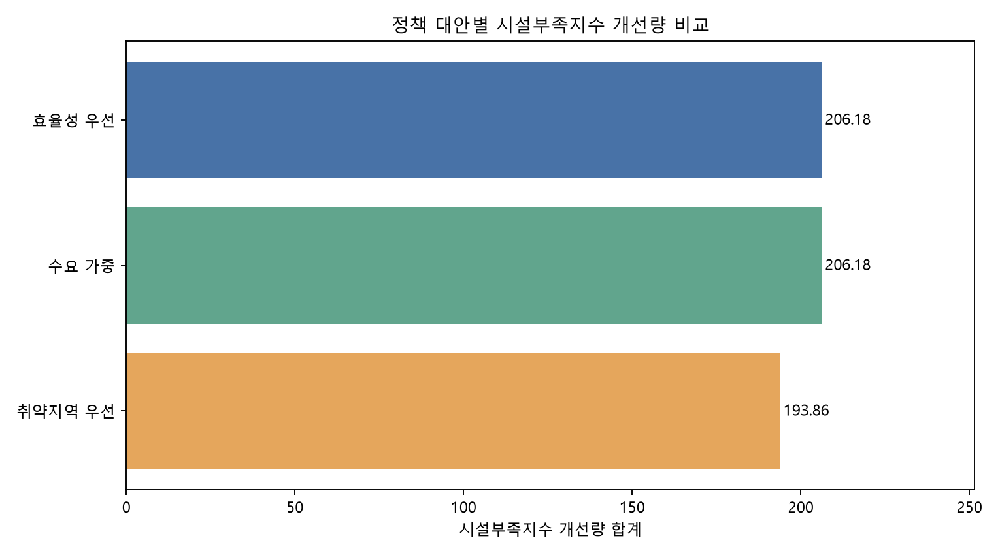
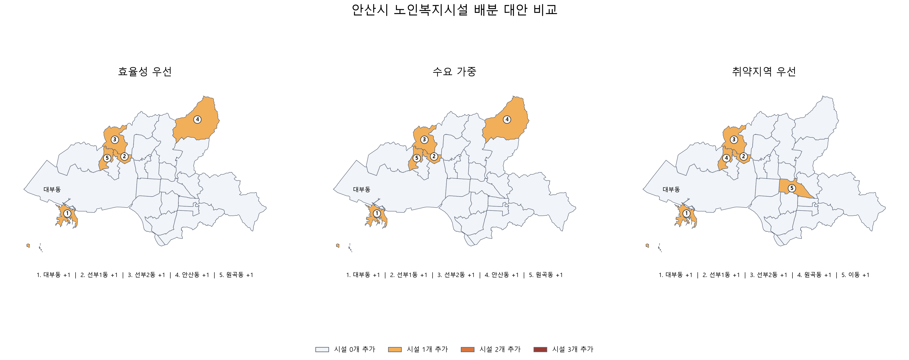

# 안산시 공공데이터 기반 복지시설 배분 의사결정 지원

Python, GeoPandas, PCA, K-Means 및 정책 시뮬레이션을
활용한 데이터 기반 의사결정 지원 프로젝트입니다.

## 프로젝트 목적

안산시 25개 행정동의 고령인구 및 복지시설 자료를
통합하고 지역별 특성을 비교합니다.

제한된 시설 공급 조건에서 대안별 결과를 분석하여
의사결정에 필요한 기초자료를 제시합니다.

## 분석 구조

1. 공공데이터 수집 및 데이터 품질 확인
2. 시설 주소·좌표와 행정동 경계 공간조인
3. PCA 및 K-Means 기반 지역 특성 분석
4. 별도 시설부족지수 설계
5. 시설 총 5개 배분 대안 비교
6. 지도 및 HTML 보고서 생성

## 주요 기술

- Python / pandas / NumPy
- GeoPandas / Shapely
- scikit-learn / PCA / K-Means
- Matplotlib / Folium
- pytest

## 핵심 결과

- 25개 행정동 분석
- 75개 단일 지역 시설 확충 시나리오
- 효율성, 수요 가중, 취약지역 우선 3개 배분 대안 비교
- 총 5개 시설 추가, 행정동별 최대 3개 제약

## 문서

- [분석 방법론](docs/METHODOLOGY.md)
- [분석 결과](docs/RESULTS.md)
- [한계 및 유의사항](docs/LIMITATIONS.md)
- [재현 실행 안내](docs/WORKFLOW.md)

## 해석상 주의

본 프로젝트는 가상 투자 대안 비교를 위한 분석입니다.
정책지수 개선은 실제 복지 효과, 투자수익률 또는
최적 입지의 실증적 증거를 의미하지 않습니다.

데이터 및 분석상의 한계는 LIMITATIONS 문서를 참고하세요.
